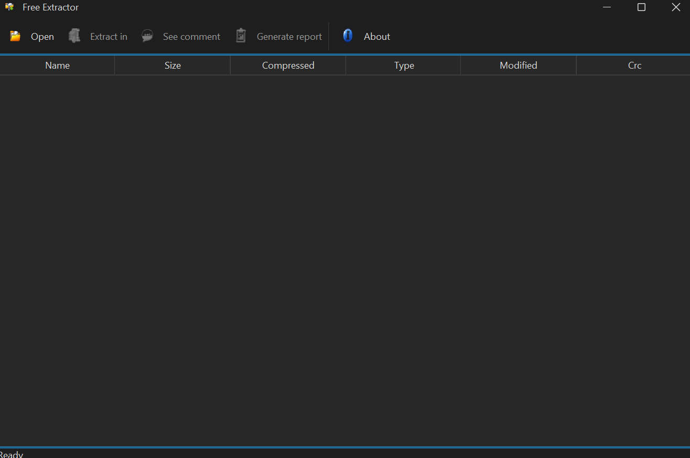

# Extractor de archivos comprimidos

Aplicación de escritorio para explorar y descomprimir archivos **ZIP, RAR, 7-Zip y TAR** (entre otros), con soporte para archivos protegidos con contraseña. Usa la biblioteca 7-Zip-JBinding.

## Características

- Vista de contenido del archivo (nombre, tamaño, fecha) antes de extraer.
- Extracción con barra de progreso, sin bloquear la ventana.
- Soporte para archivos con contraseña y para ver el comentario del archivo.
- Exporta un informe del contenido.
- Protección contra rutas maliciosas (Zip Slip): nunca escribe fuera de la carpeta de destino.
- Interfaz moderna con el tema FlatLaf; multiplataforma (Windows, Linux y macOS).

## Requisitos

- JDK 21 y Maven 3.9 o superior.

## Compilar y ejecutar

```bash
mvn clean package
java -jar target/mvn-extractor-1.0.0-launcher.jar
```



## Notas

- Las bibliotecas nativas de 7-Zip van incluidas en el JAR (`sevenzipjbinding-all-platforms`).

## Licencia

Código de ejemplo de uso libre con fines educativos.
